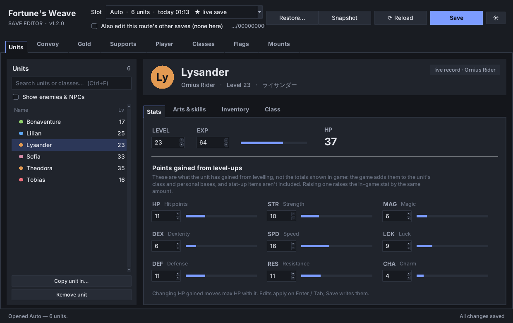
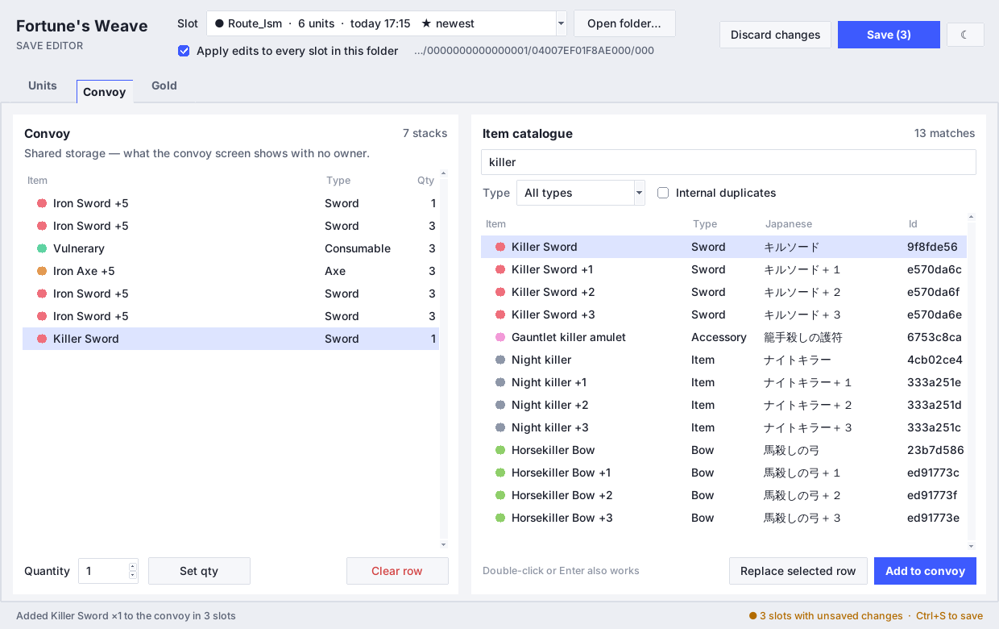

# Fortune's Weave Save Editor

A save editor for **Fire Emblem: Fortune's Weave** saves made by the Eden
Switch emulator. It edits your playthrough (units, items, convoy, gold, skills,
flags) and leaves the game itself alone. Plain Python + Tkinter, one extra
library, or a ready-made Windows `.exe`.

> **Unofficial and reverse-engineered.** Close the game before saving and keep
> your own backup. The first save next to each slot also keeps the untouched
> original as `<slot>.bak`, and every save after that keeps the copy it replaced
> as `<slot>.bak1`, `.bak2` and so on (highest number = newest), so a game
> auto-save that landed between two editor saves is never lost. Backups are
> never deleted or renamed; clear out old ones yourself when you like.



## What you can edit

| Page | What |
|---|---|
| **Units** | Level, EXP, HP and stat gains; carried items; classes; arts and skills. Add a character from the catalogue, copy one from another save, remove one, restore recruitment, or change its **Unit #**, with duplicate checks. |
| **Convoy** | Add, swap or remove items and materials (including Building Materials), change quantities, stock all materials, and repair damaged storage lists. |
| **Player** | Gold, renown EXP and Karma Shards; difficulty, mode and playthrough number; Part 1/2 and Eshmel Part 3 chapter selection, optional chapter-start files, and **Troubleshoot Progress**. |
| **Classes** | Current and learned classes, class EXP, weapon ranks and mastery EXP, with batch editing. |
| **Supports** | Support points, current level and next-level requirements, and recorded conversations. |
| **Mounts** | The battalion and mount each unit carries, chosen from the save's pool. |
| **World map** | Show or hide places and roads, and mark places visited. |
| **Tutorials** | Make tutorial records available or remove them, with category, state and name-evidence filters. |
| **Blessings** | Stored EXP for all seven gods and available first-audience controls. |
| **Fast travel** | Add or remove identified Dagsion destinations. |
| **Functions** | Facility and feature availability, area access, and city movement restrictions. |
| **Notable Deeds** | Progress counters and milestone information, with claim states and rewards shown separately. |
| **Boons** | Set tiers, remove ownership, switch owned Boons On/Off, or set all to maximum. |
| **Flags** | Search and edit named save variables, including recruitment, conversations and unlocks. English names appear beside the original Japanese identifiers. |

Edits support **Undo/Redo** (Ctrl+Z / Ctrl+Y). **Snapshot** / **Restore…** keep
copies of the whole save folder. Frequently used save data is cached to keep
switching pages and editing large lists responsive. The window sizes to fit your
screen; longer forms and previews scroll, action buttons stay visible, and
**Go to tab** reaches every page when the tab strip is too wide.

### Story progression

Chapter selection is available from **Player → Story progression…**:

| Story | Available chapters |
|---|---|
| Leda Part 1 | 2–12 |
| Cai Part 1 | 1–12 |
| Dietrich Part 1 | 3–12 |
| Theodora Part 1 | 1–12 |
| All four routes, Part 2 | 1–6 |
| Eshmel Part 3 | 2–6, on existing Eshmel Part 3 saves only |

Leda Part 1 Chapter 1, Dietrich Part 1 Chapters 1–2 and Eshmel Part 3 Chapter 1
are unavailable because replay can block progression. Start Part 3 Chapter 1
naturally through the Obelisk door. Part 3 Chapters 2–5 passed their opening and
next story event; Chapter 6 was checked only as far as its opening battle.
Complete playthroughs and every Obelisk checkpoint have not been validated.

Chapter selection preserves your party and earlier progress; it does not grant
all skipped units, facilities or quests. Known access fixes are applied where
needed, including Part 2 temple and midtown access. Theodora Part 1 Chapter 6
may still require the alternate route around the city barrier. **Troubleshoot
Progress** reads the current character, part and chapter and offers a known
repair where one exists. If none is known, it points to the upstream issue page.

**Try Part 2 entry…** offers experimental entry from a supported Part 1 save.
It does not reproduce the whole native transition or create the separate
`Part_<lord>_2` handoff file. Part 3 selection does not create missing route
completion or carryover state. Story changes and troubleshooting apply only to
the selected save, even when mirroring is enabled.

You can optionally create the selected chapter's checkpoint file when saving.
Existing files require confirmation and receive a backup. Battle states are
not supported for story changes.

### Adding units

**Add unit…** uses each enabled character's level-one defaults. It checks for
existing characters and allocates an unused unit number. **Restore recruitment**
re-enables the relevant flags for an existing eligible record while retaining
its stats and inventory; it is not a general revival feature. Manual number
changes also reject collisions.

The catalogue has **67 enabled characters**, including special characters with
individual notes. Add Unit and recruitment restoration support the four Part
1/2 routes and Eshmel Part 3 in recognized **free-time, normal pre-battle and
chapter-start** saves. Pre-battle additions show a warning: units may have
reduced HP/stats or be absent from the editor view. Mid-battle additions are
disabled; world-map battle states are unsupported. Copying and renumbering
remain limited to free-time saves.

Some characters need equipment from the convoy. Anna starts dismounted; mounted
deployment has also worked in Part 3, but remounting and map eligibility are not
established. Eshmel's special entry has a helmeted portrait and a generic
unhelmeted battle model. Read each character's preview for its limitations;
these entries are not a guarantee of natural recruitment or every story context.

### Stats

The nine stored numbers are what a unit has **gained from level-ups**. The game
adds the class and personal bases (and stat-up items) on top, so the editor's
numbers are lower than the unit screen; raising one raises the in-game stat by
the same amount. Max HP is stored separately and always equals a fixed base
plus the HP gained, so changing HP gained moves max HP with it.

### World map

The save keeps one small record for each of the map's 864 points: 310 places
(towns, forts, temples, caves…) and 554 invisible junctions and road points
that the 717 roads are drawn through. The page lists them by their English
name, with the game's own name beside it, and writes two bytes per point:
**shown / hidden** and **visited**. Nothing else in the record is touched and
no record changes size.

* **Show / Hide** on places affects the places only. On a *road*, **Show**
  shows every point of the road (including the places and junctions it
  joins); **Hide** hides only the points that belong to that road, never a town
  or a junction other roads share.
* **Show all places** and **Show all roads** are the quick unlock; a road
  you haven't earned yet will then be drawn. Ctrl+Z undoes either.
* Showing a place does not open what is behind it. Gates, battles, rewards,
  quests and fast travel have their own conditions in the save and are not
  touched. The game may also recalculate map state as the story advances.
* State `2` on some road points isn't understood yet, so the page shows it as
  it is and only changes it when you pick that row.

The byte layout and the behaviour of the two bytes were worked out by
[@Destorino5](https://github.com/Destorino5) in
[#27](https://github.com/Antiadvocate/fefw-editor/issues/27).

### Not supported (yet)


* **Total stats and stat-up item bonuses.** See *Stats* above.
* **Movement.** Units have their own movement values; where they're stored isn't
  known yet.
* **Weapon-rank rewards and skill effects.** Raising a rank only changes the
  letter, and adding a skill doesn't grant an effect the class or level wouldn't
  allow. Skills and arts the game hands out when a rank is reached in play are
  not added.

If you know where any of these live, contributions are welcome.

## Download

The [upstream releases](https://github.com/Antiadvocate/fefw-editor/releases/latest)
provide Windows and Linux builds. Their included features depend on the release;
run this branch from source to use everything listed above.

* **Windows:** unzip the Windows package and run `FEFW Save Editor.exe`.
  Python is not required. The executable is not code-signed, so SmartScreen
  may ask for confirmation.
* **Linux (x86-64):** extract the Linux package and run `./fefw-save-editor`.
  It requires glibc 2.35 or newer and runs under X11 or XWayland.
* **macOS / other platforms:** run from source below.

Keep the editor in a folder you can write to; its settings are saved beside it.

## Running from source

Use **Python 3.10 or later**, with Tkinter and `zstandard`. Python 3.10 and 3.12
are the versions used for validation; Python 3.12 is recommended.

With Python 3.12 and Tkinter installed, on Linux/macOS:

```sh
python3.12 -m venv .venv
.venv/bin/python -m pip install -r requirements.txt
.venv/bin/python editor.py
```

On Windows:

```powershell
py -3.12 -m venv .venv
.\.venv\Scripts\python.exe -m pip install -r requirements.txt
.\.venv\Scripts\python.exe editor.py
```

Alternatively, use your distro packages:

```sh
# Arch
sudo pacman -S tk python-zstandard
python editor.py

# Debian / Ubuntu
sudo apt install python3-tk python3-zstandard
/usr/bin/python3 -s editor.py
```

On Bazzite, the Debian/Ubuntu commands can be used inside an Ubuntu Distrobox.
The Windows `FEFW Save Editor.bat` launcher also works once its Python has the
dependencies installed. To open a particular save folder or slot:

```sh
python editor.py "/path/to/save"
```

## Finding your save

```
%APPDATA%\eden\nand\user\save\<play-uid>\<account>\04007EF01F8AE000\000\
```

The editor finds this on its own and remembers the last folder you opened.
Otherwise use **Open folder…** and pick any slot file inside it.

## How saving works

* **The slots.** `Auto` is your latest save on whichever lord's route you last
  played, and it opens first. `Route_<lord>` (e.g. `Route_Ism`) holds that
  lord's route while you play someone else. `Chapter_<lord>_<part>_<chapter>`
  are chapter checkpoints, the points the game's "go back in time" feature
  returns to. `Part_<lord>_<part>` are part checkpoints. `Global` is maintained separately by the game; its progression and carryover
  data are not fully mapped by this editor. The slot list shows the lord, part and chapter each slot was saved in
  (e.g. `★ Auto · Theodora P1 Ch12`), read from the save itself; ★ marks `Auto`.
* **Edit `Auto`.** It's the save the game continues from, so editing it alone is
  enough.
* **Only the live data is changed.** `Auto` also carries its own copies of
  earlier points (the chapter start and, mid-battle, older states). Edits go to
  the live unit, convoy and gold; those copies keep their values, so rewinding
  still takes you back to what was really there. Run settings (difficulty, mode,
  playthrough number) are the exception: they apply to the whole run and are
  written into every copy. Story progression deliberately clears old internal
  restart snapshots so the game can rebuild the selected chapter start.
* **"Also edit this route's other saves"** (off by default) also writes each edit
  into matching live saves of the same character, part and playthrough, e.g.
  that lord's `Route_*`. This includes Tutorials, Blessings/audiences, Fast
  Travel, Notable Deeds, Boons, Add Unit, Functions and named flag edits, as well
  as existing unit, inventory, map and support edits. Targets are checked before
  applying the added features' edits, and Undo/Redo restores them together.
  Another route/part/playthrough and every `Chapter_*` checkpoint are excluded. Open a
  checkpoint to edit it on its own. The separate Story progression checkbox can
  create or replace its selected chapter file on Save, with confirmation and backup.
* **Nothing is written until you press Save** (Ctrl+S). Slots with unsaved
  edits get a ● in the slot list, and quitting with unsaved edits asks first.
* **Reload (F5)** re-reads every slot from disk. When you switch back to the
  editor, a slot the game saved since is re-read on its own if you haven't
  edited it; if you have, Save warns you before overwriting the game's newer
  save.
* **Snapshots** are stored in a `_snapshots` folder next to your slots.

Lists grow and shrink safely: the save is a tree of records that point at each
other, and when a list changes size every pointer after it is rewritten and the
result is read back before anything is written.



## The convoy

The convoy is a fixed row of 1329 slots, one per item: each item has its own
slot, and a stack sitting in another item's slot is ignored by the game.
**Add item…** puts a stack in the item's own slot (adding to what is there) and
**Remove** empties a slot, so the list always keeps its 1329 slots.

**All materials…** asks for one quantity and stocks all 128 forging and cooking
materials (ores, meat, fish, plants, leaves, manure) at it, each in its own
slot. Undo takes it back.

**Fixing 1.3.1.** Version 1.3.1's Add item… and All materials… put stacks in the
first empty slot, so the game never showed them. Running All materials… again
moves stray materials home, and adding an item again moves its stray copies
into its own slot.

**Damaged lists.** Versions before 1.2 did "Add" by writing an item over empty
slots, which knocked the rest of the list out of line so the game couldn't read
it (materials stored after that point seemed to vanish). The Convoy page detects
such a list and offers **Repair convoy**: it rebuilds a clean list with every
item it can still find. Undo works, and the original stays in the slot's `.bak`.

## Finding items and skills

The catalogues search English name, Japanese name and id as you type; every word
must match, so `silver bow` or `+3 sword` narrow it down. The item catalogue has
a **Type** filter (Sword, Lance, Tome, Accessory…), and forged copies show their
level (`Silver Axe +2`) even where the game's English text leaves it out. When
you pick an inventory slot, only items of the same kind are offered; tick *Allow
any item type* to override. The skill picker lists skills with an English name
first.

**Icons:** items get a coloured dot by type and units an initials badge. Drop
PNGs into `icons/items/` and `icons/units/` to use real images; see
[icons/README.md](icons/README.md).


## Keyboard

| Key | Does |
|---|---|
| Ctrl+S | Save every changed slot |
| Ctrl+Z / Ctrl+Y | Undo / redo |
| Ctrl+O | Open a save folder |
| Ctrl+F | Jump to the search box on the current page |
| Ctrl+Tab / Ctrl+Shift+Tab | Move between pages |
| Ctrl+A | Select every row in the table you last clicked |
| Shift+click / Shift+drag | Select a range of rows (convoy, classes, masteries, flags…) |
| F5 | Reload every slot from disk (asks first if you have unsaved edits) |
| Enter / double-click | Use the selected catalogue item |

## Known limits

* Changing a class writes the class id and the unit's class list; usable weapons
  and class skills that come with a class are not recalculated.
* EXP is a running total (`(level - 1) × 100 + EXP into the level`); the editor
  shows and writes the part inside the level, 0–99.
* Renown is stored as exp. Which level that is comes from the game's own
  tables, so the editor shows exp, not a level.
* A flag whose name isn't in the game's data files shows as `unknown 0x…`. It's a
  real flag that nothing in the data names (roughly 40% of a mid-game save's
  flags resolve).
* Enemy and NPC records can be viewed but not edited; their layout is only partly
  known.
* Built and tested against saves from one game version. Another version may need
  the name tables rebuilt; unknown ids then show as `unknown <hash>`.

* Tutorial records and menu visibility are separate: the game can hide
  scenario-specific entries or unlock tutorials again during play.
* Showing a map point or travel destination does not necessarily unlock its
  facility, gate or story event. Functions exposes separate controls where known.
* Fortuna's Blessings EXP effect is unknown. Divine Sand and selection are
  read-only; other gods have known level previews.
* Deed counter changes preserve reward claim records and currency. Lowering
  progress below a claimed milestone can make the game clear that claim.
* Inferred mappings remain labelled in the editor; they are not guarantees of
  in-game behavior.

## Files

| Files | Purpose |
|---|---|
| `editor.py`, `editor_advanced.py`, `*_page.py` | Interface and feature pages |
| `fefw_core.py`, `fefw_layer.py`, `fefw_save.py` | Save parsing, edits, checksums and writing |
| Feature modules and `.json` catalogues | Units, story, supports, maps, tutorials, blessings, functions, deeds and Boons |
| `build_*.py`, `msbt.py` | Rebuild name and item tables from your own game dump |
| `icons/` | Optional item and unit images |
| `requirements.txt`, `FEFW Save Editor.bat` | Source dependencies and Windows launcher |
| `.github/workflows/` | Source checks and release packaging |

`editor_settings.json` is created beside the editor on first use.
Research scripts, test suites and development reports are retained on the
[feature branches](https://github.com/Destorino5/fefw-editor/branches), including
[Part 3 story](https://github.com/Destorino5/fefw-editor/tree/feature/part3-story),
[Part 2 story](https://github.com/Destorino5/fefw-editor/tree/feature/part2-story)
and [unit creation](https://github.com/Destorino5/fefw-editor/tree/feature/unit-creation).

### Rebuilding the name tables

The `.json` name tables come from the game's own data. To rebuild them for a
different game version, point the scripts at a romfs dump of your own copy of
the game:

```
python build_item_names.py <romfs folder>
python build_unit_names.py <romfs folder>
python build_skill_ids.py <romfs folder>
python build_flag_names.py <romfs folder>/GameData
python build_map_spots.py <romfs folder>
```

`build_item_names.py` replaces the English item names (until now translated
from the Japanese ids, e.g. "Augus' teff") with the game's own English text
("Orgus Coffee"), matched through the game's message files. Items the game's
text never names (cut content, cutscene props) get hand translations.
`build_unit_names.py` names the generic soldiers, enemies and NPCs whose ids are
Japanese (`EN_女斧盗賊2` → "Axe Thief (female, 2)") from the class, people and
place names in the same files.

## Making a release

1. Bump `__version__` in `editor.py` (e.g. `"1.2.1"`) and merge to `main`.
2. Actions → **Release** → *Run workflow*, and enter the matching tag
   (`v1.2.1`). Pushing that tag works too.

The workflow ([.github/workflows/release.yml](.github/workflows/release.yml))
checks the tag matches `__version__`, builds the Windows `.exe` with
PyInstaller, zips it with the README and the `icons/` folder, adds a source zip
and publishes the release.

## Disclaimer

No warranty. Editing saves can corrupt them, and this was built by studying a
handful of save files; behaviour may differ on other game versions. Keep your
own backups.
