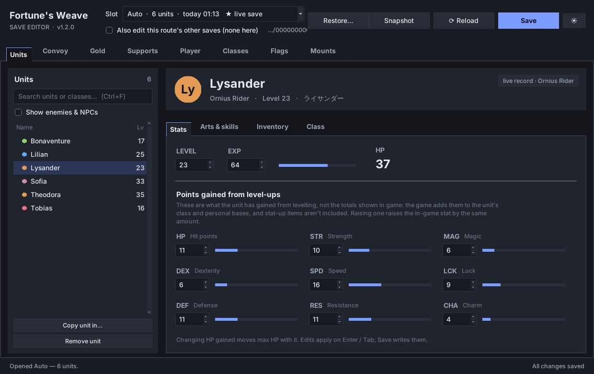
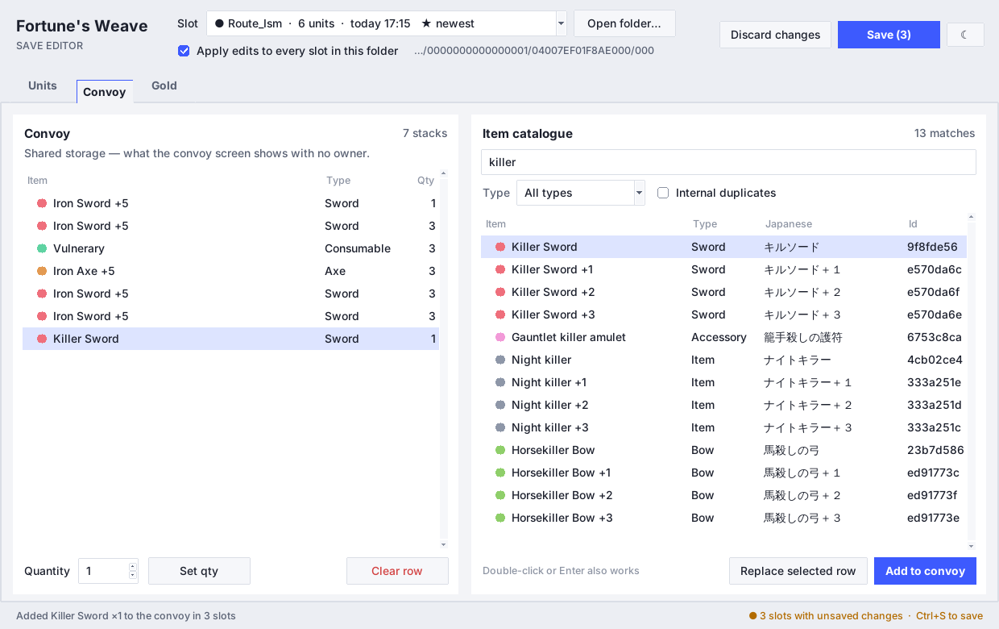

# Fortune's Weave Save Editor

A save editor for **Fire Emblem: Fortune's Weave** saves created by the
Eden / eglantine Switch emulator. Plain Python + Tkinter, one extra library.

> **Unofficial and reverse-engineered.** The first save next to each slot keeps
> the untouched original as `<slot>.bak` — but keep your own backup too.



## What you can edit

| Page | Tab | What |
|---|---|---|
| **Units** | Stats | Level, EXP, max HP, and the points each of the nine stats has gained from level-ups (see below) |
| | Weapon ranks | Rank EXP for every rank the unit owns, with the letter grade, progress to the next grade and a one-click "set every rank to…" |
| | Inventory | Swap any carried item for another, picked from a searchable catalogue (known spells are listed too, read-only) |
| | Class | Pick any class the game knows (searchable, English + internal name) |
| **Convoy** | | Everything in storage, materials included: swap the item in any row or change its quantity |
| **Gold** | | Set gold. Found automatically in Theodora-route saves; other slots locate it once by the amount the game shows |

### What it doesn't do (yet)

This edits the parts of the save that have been mapped, not the whole game. Not
supported:

* **Total stats.** The nine stored numbers are what a unit gained from level-ups;
  the game adds class and personal bases (and any stat-up items) on top. So the
  editor's numbers are lower than the unit screen, and raising one raises the
  in-game stat by the same amount. Stat-up item bonuses aren't located yet.
* **Movement.** Units have their own movement values. Where they're stored isn't
  known yet.
* **Weapon-rank rewards.** Raising a rank only changes the letter; skills and
  combat arts granted on reaching a rank in play are not added.
* **Skills, combat arts, supports, renown, mounts, battalions, karma shards.**
  Skills and arts are stored as lists of hashed ids per unit, and without the
  game's name table they can't be shown or edited meaningfully. The others
  haven't been found in the save yet.

If you know where any of these live (offsets, a cheat table, the game's data
files), contributions are welcome.

## Download

Grab the latest build from the
[**Releases page**](https://github.com/Antiadvocate/fefw-editor/releases/latest):

* **Windows:** `FEFW-Save-Editor-<version>-windows.zip` — unzip it anywhere you
  can write to and run `FEFW Save Editor.exe`. No Python needed. The exe isn't
  code-signed, so SmartScreen may ask you to click *More info → Run anyway*.
* **Anything else:** `…-source.zip`, then follow *Running from source* below.

## Running from source

```
pip install -r requirements.txt
python editor.py
```

or double-click **FEFW Save Editor.bat** on Windows. Python 3.10+.

You can also pass a folder (or any slot file) on the command line:
`python editor.py "C:\path\to\save\folder"`.

## Finding your save

```
%APPDATA%\eden\nand\user\save\<play-uid>\<account>\04007EF01F8AE000\000\
```

The editor finds this on its own (most recently played first) and remembers
the last folder you opened. Otherwise use **Open folder…** and pick any slot
file inside it.

## How it works

* **Every slot in the folder is loaded, and `Auto` opens first.** `Auto` is
  the live save the game continues from, so editing it alone is enough. The
  drop-down marks it ★ and labels the `Chapter_*` checkpoints.
* **Reload (F5) re-reads every slot from disk.** The editor also checks when
  you switch back to its window. If the game saved since, a slot with no
  unsaved edits is re-read on its own. If you have unsaved edits in it, Save
  warns you instead of overwriting the game's newer save.
* **Nothing touches the disk until you press Save** (Ctrl+S). Edits are held in
  memory; slots with pending changes get a ● in the drop-down and the Save button
  shows how many will be written.
  Quitting with unsaved changes asks first.
* **What the slots are.** `Auto` is your latest save on whichever lord's route
  you were last playing. `Route_<lord>` (e.g. `Route_Ism`) is that lord's route
  while you play someone else. `Chapter_<lord>_<part>_<chapter>` are chapter
  checkpoints, the points the game's "go back in time" feature returns to.
  `Global` holds settings only.
* **"Apply edits to this route's other saves"** (off by default) also writes
  each edit into the route's other live saves, e.g. that lord's `Route_*`.
  Another lord's route is never touched, and neither is any `Chapter_*`
  checkpoint, so each point in time keeps its own state. Open a checkpoint to
  edit it on its own.
* A unit is stored as **several copies** inside one slot. Every edit goes into
  all of them; the header shows "copies in sync", or offers *Make copies match*
  if they disagree.
* **Close the game before saving.**



## Finding items

The item catalogue (Inventory and Convoy) searches English name, Japanese name
and id at once, as you type. Every search word must match, so `silver bow`
or `+3 sword` narrow things down. Use the **Type** filter (Sword, Lance, Tome,
Accessory, …) to cut it further. Forged copies show their level (`Silver Axe +2`)
even where the game's English text leaves it out.

When you pick an inventory slot, the catalogue only offers items of the same
kind (weapons for a weapon slot, etc.); tick *Allow any item type* to override.

**Icons:** items get a coloured dot by type and units an initials badge. Drop
PNGs into `icons/items/` and `icons/units/` to use real images — see
[icons/README.md](icons/README.md).

## Keyboard

| Key | Does |
|---|---|
| Ctrl+S | Save every changed slot |
| Ctrl+O | Open a save folder |
| Ctrl+F | Jump to the search box on the current page |
| F5 | Reload every slot from disk (asks first if you have unsaved edits) |
| Enter / double-click | Use the selected catalogue item |

## Known limits

* Only the class **id** is written. Usable weapons and class skills that come
  with a class are not recalculated here.
* A unit only has entries for the weapon ranks it owns. The others display `E` in
  game and can't be added from here — the list is fixed-size inside the record.
* Gold is found automatically wherever its record exists (`Auto` and the
  Theodora-route files so far). Only the live record near the start of the save
  is written; chapter and battle snapshots keep their own amount. Slots without the record
  (the Ishmael files) still need it located once by the amount the game shows.
* **Adding to or emptying a convoy slot isn't supported.** The convoy is a fixed
  row of 1329 slots, and an empty slot is smaller than a filled one, so either
  would shift every slot after it. Put any spare item into the convoy in game,
  save, then replace it in the editor. (Older versions did "Add" by writing over
  empty slots, which knocked the rest of the list out of line. The Convoy page
  shows a warning on a list damaged that way.)
* Enemy and NPC records can be viewed but not edited — their layout is only
  partly known.

## Files

```
editor.py            the GUI
fefw_save.py         save container, unit records, all the edits (also a small CLI)
unit_ids.json        person id  -> name
item_ids.json        item id    -> Japanese + English name
job_ids.json         class id   -> Japanese + English name
icons/               optional item / unit images
requirements.txt     zstandard
FEFW Save Editor.bat launcher (source install)
.github/workflows/   release build
```

`editor_settings.json` (theme, last folder, options) and `money_sig.json` (where
gold lives) are created next to the editor (or next to the `.exe`) on first use.

The three id files are generated from the game's own data files. A different
game version may need them rebuilt; unknown ids then show as
`unknown <hash>` instead of a name.

## Making a release

1. Bump `__version__` in `editor.py` (e.g. `"1.0.1"`) and commit.
2. Push a matching tag:

   ```
   git tag v1.0.1
   git push origin v1.0.1
   ```

GitHub Actions ([.github/workflows/release.yml](.github/workflows/release.yml))
builds the Windows `.exe` with PyInstaller, zips it with the README and the
`icons/` folder, adds a source zip and publishes the release. It can also be run
by hand from the Actions tab.

## Disclaimer

No warranty. Editing saves can corrupt them, and this was built by inspecting a
handful of save files — behaviour may differ on other game versions. Keep your
own backups.
