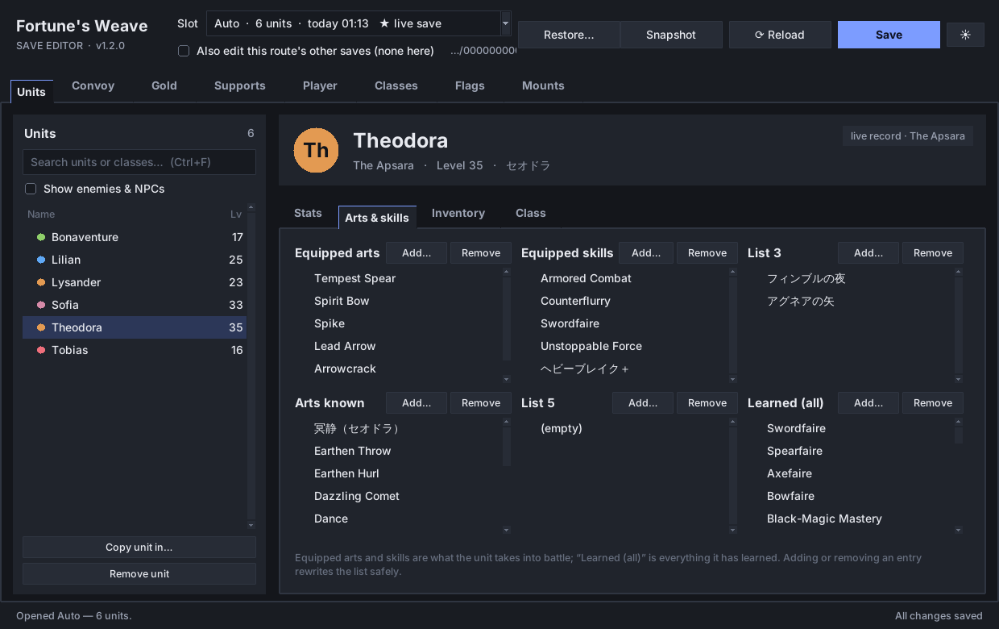

# Fortune's Weave Save Editor

**Eshmel Part 3:** Player offers provisional Chapters **2–6** on supported
Eshmel Part 3 free-time and chapter-start saves. This does not convert other
characters or earlier parts into Part 3. Chapters 2–5 passed opening and progression checks; Chapter 6 reached its
opening battle only. Chapter 1 is unavailable because replay cannot progress; use the Obelisk door to start it naturally. Battle and unknown resume states remain read-only for story changes.

**Mirroring:** “Also edit this route’s other saves” now covers Tutorials,
Blessings and audiences, Fast Travel, Notable Deeds, Boons, Add Unit, Functions,
and named flag changes, alongside Maps, Support and existing unit/inventory
edits. Targets must match character, part and playthrough; chapter checkpoints
remain excluded. Added-page edits validate all targets before applying, and
Undo/Redo restores the affected saves together. Add Unit supports the four Part 1/2 routes and Eshmel Part 3
free-time, normal pre-battle and chapter-start saves with recognized layouts. It allocates unused numbers independently in each save. Pre-battle additions require acknowledging a warning about reduced HP/stats and editor visibility. Mid-battle additions are disabled; world-map battle states remain unsupported.
Story progress and its chapter-specific troubleshooting repairs stay selected-only.


**New-unit test feature:** Units now has **Add unit…**, a visible **Unit #**,
and guarded number editing. The searchable catalogue enables 67
level-one candidates, blocks duplicate characters/numbers and preserves existing
unit progress. Eshmel is a special case with a helmeted portrait but a generic unhelmeted battle model. Anna starts dismounted; mounted deployment has also passed a Part 3 Chapter 2 test. The four Part 1/2 routes and Eshmel Part 3 are supported. Renumbering and importing remain limited to free-time saves.
See [scope and identity rules](docs/unit-creation.md) and the
[focused test guide](docs/testing-unit-creation-test1.md).
The first game returns passed for the deployed additions and renumbered Sirocco;
Olympia later passed deployment, and renumbered Catania passed control; Buccar's story departure prevented that check. The restoration
follow-up fixes Flags value editing and distinguishes primary recruitment flags
from alternate/unverified aliases. See [results and the focused retest](docs/unit-restoration-fix.md).

**Story progression — Leda Part 1:** Player offers **Chapters 2–12**, all tested
through the opening and next main story beat. Chapter 1 is unavailable: its
opening plays, but the first objective does not advance. Optional chapter-file
creation on Save passed UI/backup checks and Obelisk loading for Chapters 8/9.
Other Leda chapter files remain untested through the Obelisk.

**Cai Part 1:** Chapters **1–12** passed opening and progression tests, including
Chapter 4 direct entry with the Sewers fix. Cai Obelisk use remains untested.
See [Cai/Tutorials Test 5 results](docs/test-results-cai-tutorials-test5.md).

**Dietrich Part 1:** Chapters **3–12** are available and passed short-session
opening/progression checks, including direct entry for Chapters 5/6 and the
Chapter 7 teaching objective. **Chapters 1 and 2 are unavailable:** Chapter 2
replay blocks at the rescue, and Chapter 1 leads into it. Existing native saves
still load normally. [Test 3 results](docs/test-results-story-dietrich-test3.md)
record the failed Chapter 2 diagnostics and accepted 5/6 entry paths.
Chapter selection applies the tested prerequisites for 5–7 while preserving
party and tutorials. All Test 1 UI checks passed. Dietrich Obelisk use and
long term progression remain untested.

**Theodora Part 1:** Chapters **1–12** passed short-session checks. Chapter 2
enters battle directly. Chapters **4/6/8/9** passed with the focused Test 2
repairs, now applied during chapter selection. Chapter 6 uses an alternate city
route; its NPC barrier remains. Chapter 8 removed that barrier. Chapter 9 needs
only the three-point Troy exit. Party, tutorials and unrelated flags/map points
are preserved. Chapters 1/2 use 1446; Chapter 3+ uses 1449.
See [Test 2 results](docs/test-results-story-theodora-test2.md).

**Performance:** repeated save parsing is cached with byte-level invalidation,
and chapter entry skips rebuilding already-empty restart blobs. See the
[optimisation measurements and validation](docs/performance-2026-11-17.md).

**Tutorial names:** 180 titles, categories and their visible order now match the
supplied game screenshots. This corrects 61 labels, including **Mentoring (Cai)**;
38 scenario-specific titles remain provisional. They use a separate game-data
category and are absent from the tested Leda menus even with their records saved.
Tutorials now distinguishes stored records from menu visibility; natural game
unlocks can add entries again. Exact keys are unchanged. See the
[category investigation](docs/tutorial-menu-visibility.md).

**Functions** replaces the Facilities tab. Its 41 switches include
**Sewers access (Cai)** under Area access. Selecting Cai Chapter 3 or later
also enables this prerequisite automatically, with Undo/Redo and Save.
Other earlier unlocks and party units still require separate changes.
Area access now also includes **upper, middle and lower/port movement** and
the **wealthy–commercial district passage**. Enable clears the corresponding
movement restriction; the ordinary upper/lower access and Trading Company
switches remain separate. Each row states its tested scope.
The Journal, Mentoring and Dagsion area controls remain available with their
individual evidence labels. Arena testing remains deferred.
See [Sewers results and editor checks](docs/test-results-sewers-functions.md).
The [Cai and Tutorials test kit](docs/testing-cai-tutorials-test5.md) passed its
reported checks. Dietrich Test 3 accepted integrated Chapter 5/6 entry; Chapter 2 research is parked.

**Facilities branch:** the UI and FAC-01–06 game tests passed on Leda Part 1
Chapter 9. Ten services and six gates are Game-tested; Yu Phas additionally
needs its ordinary Fast travel destination, and ten untested services remain
Inferred. See [Facilities](docs/facilities.md) and the
[acceptance report](docs/test-results-facilities-test1.md).

A save editor for **Fire Emblem: Fortune's Weave** saves made by the Eden
Switch emulator. It edits your playthrough (units, items, convoy, gold, skills,
flags) and leaves the game itself alone. Plain Python + Tkinter, one extra
library, or a ready-made Windows `.exe`.

> **Unofficial and reverse-engineered.** Close the game before saving and keep
> your own backup. The first save next to each slot also keeps the untouched
> original as `<slot>.bak`, and every save after that keeps the copy it replaced
> as `<slot>.bak1`, `.bak2` and so on (highest number = newest), so a game
> auto-save that landed between two editor saves is never lost. Backups are
> never deleted or renamed; clear out old ones yourself when you like.


## What you can edit

| Page | Tab | What |
|---|---|---|
| **Units** | Stats | Level, EXP, max HP, and the points each of the nine stats has gained from level-ups (see *Stats* below) |
| | Arts & skills | All six skill lists in the unit's record (equipped arts, equipped skills, arts known, everything learned…), by name, with add / remove |
| | Inventory | Swap, add or remove a carried item, picked from a searchable catalogue. Known spells are listed separately |
| | Class | Pick any class the game knows. It's added to the unit's own class list, the way the game does it |
| **Convoy** | | Everything in storage, materials included: add a stack, stock every material at once, swap the item in any row, change its quantity, remove a row, and repair a list damaged by older versions |
| **Gold** | | Set gold |
| **Player** | | **Troubleshoot Progress** checks the current character, part and chapter for known missing unlocks, with optional targeted repair and Undo/Redo. Offers the upstream issue tracker when no fix applies. Leda Part 1 starts 2–12, Cai 1–12 and Dietrich 3–12 (game-tested); Theodora 1–12 (passed with targeted repairs in 4/6/8/9; Chapter 6 uses alternate traversal), selected from the save route. Dietrich 1/2 unavailable because of the Chapter 2 rescue block. Other targets/routes guarded. Optional chapter file on Save with overwrite confirmation and backup. Gold, renown exp and Karma Shards; difficulty, mode and playthrough number (written into every slot, since they belong to the run) |
| **Classes** | | A unit's whole class list (set the current class, add, swap or remove one, set its exp) and its weapon masteries with their rank (E … S+) and exp — select several masteries (Ctrl+A, Shift+click or Shift+drag) and Set rank, Set exp or Remove changes all of them at once |
| **Supports** | | Every character's support partners with the **points** this save holds for the pair, the highest rank the game defines, and which conversations this save has recorded. Set the points (0 … 3200) and the game works the level out from them. **Record conversation as seen** writes that conversation's flag |
| **Mounts** | | The battalion and mount each unit carries, chosen from the save's pool |
| **World map** | | Which of the map's places, junctions and road points the save has **shown** or hides, and which places are marked **visited** (white versus dark icon). Show or hide a selection, a whole road, or every place / road at once. See *World map* below |
| **Flags** | | Every named variable the save stores: support conversations, recruited / met, achievements, feature and class unlocks. Search, filter, set, add, remove |
| **Tutorials** | | 218 tutorial identities: 180 screenshot-checked titles and 38 provisional English translations. Category/state/evidence filters, selected batches, empty-list restoration, original keys and Undo/Redo. See [tutorials.md](docs/tutorials.md) |
| **Blessings** | | Stored EXP for all seven gods, one at a time in the selected save. Six level previews tested in Leda Chapter 9; Fortuna's EXP effect remains unknown. Selection and Divine Sand are read-only. Six tested first-audience toggles; Fortuna has no audience condition. See [blessings.md](docs/blessings.md) |
| **Fast travel** | | Add/remove 20 identified Dagsion destination flags in the selected save, with original keys and undo/redo. The original 16 have screenshot-confirmed English names. Four additional flags persisted in Chapter 9 tests; only Yu Phas Temple appeared and allowed travel, while walking back in stayed blocked. See [fast-travel.md](docs/fast-travel.md) |
| **Functions** | | 41 service, gate, journal and area/movement switches, with evidence labels and read-only Arena/route/access diagnostics. See [facilities.md](docs/facilities.md) |
| **Boons** | | All 31 Boons / 81 tiers: set a tier, remove ownership, switch On/Off or set all to max. Karma and progression preserved; undo/redo. Game-tested and inferred mappings labelled. See [boons.md](docs/boons.md) |
| **Notable Deeds** | | 350 milestones; 47 editable totals; the 14 newly enabled counters are labelled Inferred. Hours Played passed its 20-hour game test. Targets/rewards and stored claim states shown separately; no currency or claim writes. See [notable-deeds.md](docs/notable-deeds.md) |

**Current build: upstream v1.3.9, with all Deed counters editable.** The 14
newly enabled counters are labelled **Inferred**; the accepted Hours test and
original counter workflow remain documented separately. Counter edits preserve
claim states, Karma and underlying story/unit progress. Existing unknown-state
checks, claim warnings, Undo/Redo and numbered backups remain available.
See the [release scope](docs/deeds-inferred-release.md).

The header shows the product/version without temporary test wording. Flags
remains the rightmost tab. Known English names appear in **Name**, with exact
original Japanese keys in **Reads As**. Shared catalogue overlays keep these
labels consistent in the running editor and generated dictionary. Future
main merges follow [AGENTS.md](AGENTS.md).

**Accepted Boons Test 4 milestone.** Corrects the eight skill-EXP
key mappings that made Test 3's Set all to max only partly work in game.
Brawling and Black-Magic level/Off keys match isolated game captures. The player
has confirmed **all Boons are On and maximum, and save/load retains them**.
Test 4's bulk-max game test is accepted on the reported setup; individual
gameplay effects and every intermediate tier are not all verified.
No general hash truncation is applied. Earlier incorrect records are preserved
but ignored when showing ownership. See [the findings](docs/boon-key-investigation.md)
and [Test 4 validation](docs/test-results-boon-skill-keys-2026-11-15.md).

Select a row and **Set selected tier**, **Remove Boon**, or use **Set all to max**.
Select the owned tier to switch it On/Off. Bulk max includes groups hidden by
search and preserves existing Off states. Save writes the selected slot;
Undo/Redo restores the entire action. **Flags is now the far-right tab.**

The locked **Weapons Discount 20%** test passed: 240/400 prices On, 300/500
Off, with level and activation persisting after reload. EXP tier 1 and Weapons
tiers 1/2 have game evidence. Brawling and Black-Magic tier 1 are **Save-verified**;
other tiers are explicitly marked **Inferred**.
The broader editor is structurally tested, without claiming every Boon's effect
has been verified in game. See the [usage guide](docs/testing-boon-levels.md),
[results and validation](docs/test-results-boon-levels-2026-11-15.md) and
[Boons format](docs/boons.md). Karma and progression are preserved.

This build merges upstream `7157e6c`: numbered `.bak`, `.bak1`, `.bak2` backups
and the preceding weapon-mastery multi-selection fix. The original `.bak` is
retained; later distinct pre-save disk states receive increasing numbers.

**Accepted milestone: Notable Deeds Test 2.** Adds 350 mapped milestones with
32 editable activity counters and 15 read-only counters. Claim states and Karma
Shards are preserved by the editor; claim rewards in game. See the [numbered test guide](docs/testing-notable-deeds.md)
and [feature/format documentation](docs/notable-deeds.md). The training completion
and claim tests passed. Lowering progress below a
claimed tier made the game clear its claim; Test 2 therefore adds an OK/Cancel
warning listing affected targets. DEED-11–14 now all passed; the Notable Deeds
milestone is accepted on the reported Leda Chapter 9 setup.
The accepted audience controls no longer say
Experimental. Three hidden travel entries say **Effect unknown**; Yu Phas Temple
retains its Chapter 9 entry restriction. POL-04/05 both passed.

Units can also be **copied in** from another slot or **removed**. Every edit can
be undone (Ctrl+Z / Ctrl+Y), and **Snapshot** / **Restore…** keep copies of the
whole save folder.

### Stats

The nine stored numbers are what a unit has **gained from level-ups**. The game
adds the class and personal bases (and stat-up items) on top, so the editor's
numbers are lower than the unit screen; raising one raises the in-game stat by
the same amount. Max HP is stored separately and always equals a fixed base
plus the HP gained, so changing HP gained moves max HP with it.

### World map

The save keeps one small record for each of the map's 864 points: 310 places
(towns, forts, temples, caves…) and 554 invisible junctions and road points
that the 717 roads are drawn through. The page lists them by their English
name, with the game's own name beside it, and writes two bytes per point:
**shown / hidden** and **visited**. Nothing else in the record is touched and
no record changes size.

* **Show / Hide** on places affects the places only. On a *road*, **Show**
  shows every point of the road (including the places and junctions it
  joins); **Hide** hides only the points that belong to that road, never a town
  or a junction other roads share.
* **Show all places** and **Show all roads** are the quick unlock; a road
  you haven't earned yet will then be drawn. Ctrl+Z undoes either.
* Showing a place does not open what is behind it. Gates, battles, rewards,
  quests and fast travel have their own conditions in the save and are not
  touched. The game may also recalculate map state as the story advances.
* State `2` on some road points isn't understood yet, so the page shows it as
  it is and only changes it when you pick that row.

The byte layout and the behaviour of the two bytes were worked out by
[@Destorino5](https://github.com/Destorino5) in
[#27](https://github.com/Antiadvocate/fefw-editor/issues/27); see
[`docs/world-map.md`](docs/world-map.md).

### Not supported (yet)


* **Total stats and stat-up item bonuses.** See *Stats* above.
* **Movement.** Units have their own movement values; where they're stored isn't
  known yet.
* **Weapon-rank rewards and skill effects.** Raising a rank only changes the
  letter, and adding a skill doesn't grant an effect the class or level wouldn't
  allow. Skills and arts the game hands out when a rank is reached in play are
  not added.

If you know where any of these live, contributions are welcome.

## Download

### Contribution test candidate

This branch adds **Notable Deeds** progress editing, **Fast travel** destination editing and a visible **Open…**
button in the top action bar. The slot selector now has its own row so it cannot
squeeze the button off-screen. Open selects a save file and loads its folder;
Ctrl+O and the existing unsaved-change prompt still work. This candidate retains
**Blessings EXP** editing for all seven gods and the tested **Tutorials** page
with 218 identities (180 screenshot-checked titles and 38 provisional translations) and
the original Japanese keys. Search, select, **Make available** or **Remove
selected**, then Ctrl+S. Ctrl+Z/Ctrl+Y undo/redo. Route mirroring is supported for
these edits; unknown records and unrelated progress are preserved.

The same labels appear in **Flags**, with the Japanese key in **Reads as**.
Adding a tutorial does not unlock the feature it describes. This is a source
test candidate; the upstream release link below does not contain this branch.

In **Blessings**, select a god, enter **New EXP**, click **Apply EXP**, then
Ctrl+S. Level buttons fill the input only. Turn off **Also edit this route's
other saves**. Fortuna (labelled Photon in Test 1) accepts raw EXP but has no
established level thresholds. All BLESS-01–11 acceptance cases passed on the
reported Leda Chapter 9 / `fefw-recomp-0.1.5` setup; six gods displayed the
tested level 2, including Kalla's decrease from level 3. Fortuna retained EXP 1;
the player also reported no noticeable Blessings-screen change at maximum
stored EXP (65535). Its gameplay effect remains unknown. EXP alone does not
establish first-audience or temple-access flags. See the report for the exact
values and coverage limits.

In **Fast travel**, search/select a destination, then **Make available** or
**Remove selected**, and Save. The catalogue covers 16 flags from the confirmed
Leda Chapter 9 restoration. OPEN-01–02 and FT-01–08 passed on the reported
setup, including removal, restoration, travel and persistence for Port,
Kalla's Temple and Stables. All 16 English labels match the supplied game
screenshots. The Stables destination does not unlock the stable facility.
Unknown records and values are preserved; sparse/ambiguous layouts refuse edits.

* [Milestone 5: Boons controlled capture guide](docs/testing-boons.md)
* [Milestone 5: Research 1 capture results](docs/test-results-boons-2026-11-15.md)
* [Milestone 5: Boons Test 1 game guide](docs/testing-boon-editing.md)
* [Milestone 5: Boons Test 1 acceptance and validation](docs/test-results-boon-editing-2026-11-15.md)
* [Milestone 5: Boons Test 2 Weapons Discount acceptance](docs/test-results-weapon-boon-2026-11-15.md)
* [Milestone 5: Boons Test 2 reproduction guide](docs/testing-weapon-boon.md)
* [Boons Test 3: all tiers usage guide](docs/testing-boon-levels.md)
* [Boons Test 3: WD20 acceptance and validation](docs/test-results-boon-levels-2026-11-15.md)
* [Accepted locked Weapons Discount 20% experiment](docs/testing-weapon-discount-20.md)
* [Deeds follow-up: 15 read-only counters queued for testing](docs/deeds-follow-up.md)
* [Milestone 4: Notable Deeds testing guide](docs/testing-notable-deeds.md)
* [Notable Deeds feature, full catalogue and binary format](docs/notable-deeds.md)
* [Milestone 4: implementation validation](docs/test-results-deeds-2026-11-15.md)
* [Milestone 3: Fast travel and Open button testing guide](docs/testing-fast-travel.md)
* [Fast travel feature, catalogue and binary-format documentation](docs/fast-travel.md)
* [Milestone 3: validation report](docs/test-results-fast-travel-2026-11-15.md)
* [Blessings feature, thresholds and binary-format documentation](docs/blessings.md)
* [Milestone 2: all seven gods test guide](docs/testing-blessings.md)
* [Milestone 2: automated and GUI test report](docs/test-results-blessings-2026-11-15.md)
* [Tutorial feature and binary-format documentation](docs/tutorials.md)
* [Repeatable game-testing guide and result template](docs/testing.md)
* [Blessings, fast travel, deeds, Boons and story research/roadmap](docs/research-status.md)

Run `python -m unittest discover -s tests -v` for automated checks. Gameplay
acceptance of the new GUI is tracked separately from prior restored-save tests.

### Upstream releases

Get the latest build from the
[**Releases page**](https://github.com/Antiadvocate/fefw-editor/releases/latest):

* **Windows:** `FEFW-Save-Editor-<version>-windows.zip`. Unzip it anywhere you
  can write to and run `FEFW Save Editor.exe`; no Python needed. The exe isn't
  code-signed, so SmartScreen may ask you to click *More info → Run anyway*.
* **Linux (x86-64):** `FEFW-Save-Editor-<version>-linux-x86_64.tar.gz`. No
  Python or pip needed. Extract it to a folder you can write to and run
  `./fefw-save-editor`:

  ```
  tar xzf FEFW-Save-Editor-*-linux-x86_64.tar.gz
  cd FEFW-Save-Editor-*/
  ./fefw-save-editor
  ```

  It needs glibc 2.35 or newer (Arch, Fedora, Debian 12, Ubuntu 22.04, Mint 21
  and later all qualify). It runs under X11 or XWayland.
* **Anything else (macOS, ARM):** `…-source.zip`, then see *Running from source*.

## Running from source

For the tutorial test candidate, **Python 3.12 is recommended**. The automated
checks have passed on Python 3.10 and 3.12, on Linux and Windows. The code's
minimum syntax version is 3.10; this does not mean dependencies have been
validated on every newer Python release. Python 3.15 is not validated.

Follow [the source setup guide](docs/source-setup.md) before the gameplay tests.
It includes a Bazzite/Distrobox route with packaged dependencies and a virtual
environment route for an existing Python 3.12 installation.

With Python 3.12 and Tkinter already installed (Linux/macOS):

```sh
python3.12 -m venv .venv-fefw312
.venv-fefw312/bin/python -m pip install --only-binary=:all: -r requirements.txt
.venv-fefw312/bin/python editor.py
```

On Arch and other distros that block system-wide `pip install`, install the
two dependencies from the distro instead and skip pip:

```
sudo pacman -S tk python-zstandard
python editor.py
```

(Debian/Ubuntu: `sudo apt install python3-tk python3-zstandard`, then use
`/usr/bin/python3 -s editor.py`.) For a virtual environment, use the explicit
Python 3.12 commands above rather than an unqualified `python` command.

or double-click **FEFW Save Editor.bat** on Windows once its Python interpreter
has the dependencies installed. You can also
pass a save folder (or any slot file in it): `python editor.py "C:\path\to\save"`.

## Finding your save

```
%APPDATA%\eden\nand\user\save\<play-uid>\<account>\04007EF01F8AE000\000\
```

The editor finds this on its own and remembers the last folder you opened.
Otherwise use **Open folder…** and pick any slot file inside it.

## How saving works

* **The slots.** `Auto` is your latest save on whichever lord's route you last
  played, and it opens first. `Route_<lord>` (e.g. `Route_Ism`) holds that
  lord's route while you play someone else. `Chapter_<lord>_<part>_<chapter>`
  are chapter checkpoints, the points the game's "go back in time" feature
  returns to. `Part_<lord>_<part>` are part checkpoints. `Global` holds settings
  only. The slot list shows the lord, part and chapter each slot was saved in
  (e.g. `★ Auto · Theodora P1 Ch12`), read from the save itself; ★ marks `Auto`.
* **Edit `Auto`.** It's the save the game continues from, so editing it alone is
  enough.
* **Only the live data is changed.** `Auto` also carries its own copies of
  earlier points (the chapter start and, mid-battle, older states). Edits go to
  the live unit, convoy and gold; those copies keep their values, so rewinding
  still takes you back to what was really there. Run settings (difficulty, mode,
  playthrough number) are the exception: they apply to the whole run and are
  written into every copy. Story progression deliberately clears old internal
  restart snapshots so the game can rebuild the selected chapter start.
* **"Also edit this route's other saves"** (off by default) also writes each edit
  into the same route's other live saves, e.g. that lord's `Route_*`. Another
  lord's route and every `Chapter_*` checkpoint are never touched. Open a
  checkpoint to edit it on its own. The separate Story progression checkbox can
  create or replace its selected chapter file on Save, with confirmation and backup.
* **Nothing is written until you press Save** (Ctrl+S). Slots with unsaved
  edits get a ● in the slot list, and quitting with unsaved edits asks first.
* **Reload (F5)** re-reads every slot from disk. When you switch back to the
  editor, a slot the game saved since is re-read on its own if you haven't
  edited it; if you have, Save warns you before overwriting the game's newer
  save.
* **Snapshots** are stored in a `_snapshots` folder next to your slots.

Lists grow and shrink safely: the save is a tree of records that point at each
other, and when a list changes size every pointer after it is rewritten and the
result is read back before anything is written.


## The convoy

The convoy is a fixed row of 1329 slots, one per item: each item has its own
slot, and a stack sitting in another item's slot is ignored by the game.
**Add item…** puts a stack in the item's own slot (adding to what is there) and
**Remove** empties a slot, so the list always keeps its 1329 slots.

**All materials…** asks for one quantity and stocks all 128 forging and cooking
materials (ores, meat, fish, plants, leaves, manure) at it, each in its own
slot. Undo takes it back.

**Fixing 1.3.1.** Version 1.3.1's Add item… and All materials… put stacks in the
first empty slot, so the game never showed them. Running All materials… again
moves stray materials home, and adding an item again moves its stray copies
into its own slot.

**Damaged lists.** Versions before 1.2 did "Add" by writing an item over empty
slots, which knocked the rest of the list out of line so the game couldn't read
it (materials stored after that point seemed to vanish). The Convoy page detects
such a list and offers **Repair convoy**: it rebuilds a clean list with every
item it can still find. Undo works, and the original stays in the slot's `.bak`.

## Finding items and skills

The catalogues search English name, Japanese name and id as you type; every word
must match, so `silver bow` or `+3 sword` narrow it down. The item catalogue has
a **Type** filter (Sword, Lance, Tome, Accessory…), and forged copies show their
level (`Silver Axe +2`) even where the game's English text leaves it out. When
you pick an inventory slot, only items of the same kind are offered; tick *Allow
any item type* to override. The skill picker lists skills with an English name
first.

**Icons:** items get a coloured dot by type and units an initials badge. Drop
PNGs into `icons/items/` and `icons/units/` to use real images; see
[icons/README.md](icons/README.md).



## Keyboard

| Key | Does |
|---|---|
| Ctrl+S | Save every changed slot |
| Ctrl+Z / Ctrl+Y | Undo / redo |
| Ctrl+O | Open a save folder |
| Ctrl+F | Jump to the search box on the current page |
| Ctrl+A | Select every row in the table you last clicked |
| Shift+click / Shift+drag | Select a range of rows (convoy, classes, masteries, flags…) |
| F5 | Reload every slot from disk (asks first if you have unsaved edits) |
| Enter / double-click | Use the selected catalogue item |

## Known limits

* Changing a class writes the class id and the unit's class list; usable weapons
  and class skills that come with a class are not recalculated.
* EXP is a running total (`(level - 1) × 100 + EXP into the level`); the editor
  shows and writes the part inside the level, 0–99.
* Renown is stored as exp. Which level that is comes from the game's own
  tables, so the editor shows exp, not a level.
* A flag whose name isn't in the game's data files shows as `unknown 0x…`. It's a
  real flag that nothing in the data names (roughly 40% of a mid-game save's
  flags resolve).
* Enemy and NPC records can be viewed but not edited; their layout is only partly
  known.
* Built and tested against saves from one game version. Another version may need
  the name tables rebuilt; unknown ids then show as `unknown <hash>`.

## Files

```
editor.py            the GUI
editor_advanced.py   Arts & skills, Player, Classes, Supports, Flags and Mounts pages
ui_util.py           table helpers: Ctrl+A and Shift+drag range selection
fefw_core.py         the save's record tree: blocks, units, resizing edits, convoy, mounts, flags
fefw_layer.py        what the GUI uses: units, items, skills, convoy and gold through fefw_core
fefw_save.py         save container (decompress, checksums, write), ids and labels, small CLI
supports.py          support pair chart, conversation-flag and support-point lookup
unit_ids.json        person id -> name
item_ids.json        item id   -> Japanese + English name
job_ids.json         class id  -> Japanese + English name
skill_ids.json       skill id  -> Japanese + English name
supports.json        support pair -> highest rank and its conversation flags
support_points.json  support pair hash -> the two characters it joins (2628 pairs)
flag_names.json      flag id   -> readable name
map_spots.json       map point hash -> name, kind, position; the road chains
worldmap.py          reads and edits the save's map points (GmapSpotMgr)
map_page.py          the World map page
tutorials.py         tutorial catalogue, list recognition and preserving edits
tutorial_page.py     the mirrored Tutorials page
tutorial_names.json  identified tutorial keys and official English names
blessings.py         seven-god identity/layout checks and EXP-only writes
blessing_page.py     the mirrored Blessings page
deed_names.json     mapped deed counter/milestone identities, targets and rewards
deeds.py            Notable Deeds locator and bounded counter-only edits
deed_page.py        the mirrored Notable Deeds page
tests/               synthetic tests and opt-in private-save regression check
build_map_spots.py   rebuilds map_spots.json from a romfs dump
build_skill_ids.py   rebuilds skill_ids.json from a romfs dump
build_item_names.py  puts the game's official English item names into item_ids.json
build_unit_names.py  English names for generic units, enemies and NPCs in unit_ids.json
msbt.py              reads the game's message files (used by the build scripts)
build_flag_names.py  rebuilds flag_names.json from a romfs dump
icons/               optional item / unit images
requirements.txt     zstandard
FEFW Save Editor.bat launcher (source install)
.github/workflows/   release build
```

`editor_settings.json` (theme, last folder, options) is created next to the
editor, or next to the `.exe` / Linux binary, on first use.

### Rebuilding the name tables

The `.json` name tables come from the game's own data. To rebuild them for a
different game version, point the scripts at a romfs dump of your own copy of
the game:

```
python build_item_names.py <romfs folder>
python build_unit_names.py <romfs folder>
python build_skill_ids.py <romfs folder>
python build_flag_names.py <romfs folder>/GameData
python build_map_spots.py <romfs folder>
```

`build_item_names.py` replaces the English item names (until now translated
from the Japanese ids, e.g. "Augus' teff") with the game's own English text
("Orgus Coffee"), matched through the game's message files. Items the game's
text never names (cut content, cutscene props) get hand translations.
`build_unit_names.py` names the generic soldiers, enemies and NPCs whose ids are
Japanese (`EN_女斧盗賊2` → "Axe Thief (female, 2)") from the class, people and
place names in the same files.

## Making a release

1. Bump `__version__` in `editor.py` (e.g. `"1.2.1"`) and merge to `main`.
2. Actions → **Release** → *Run workflow*, and enter the matching tag
   (`v1.2.1`). Pushing that tag works too.

The workflow ([.github/workflows/release.yml](.github/workflows/release.yml))
checks the tag matches `__version__`, builds the Windows `.exe` with
PyInstaller, zips it with the README and the `icons/` folder, adds a source zip
and publishes the release.

## Disclaimer

No warranty. Editing saves can corrupt them, and this was built by studying a
handful of save files; behaviour may differ on other game versions. Keep your
own backups.
